  

# 🔐 Awesome-Authentication-SSO

  
  
  
  
  
  

---

## 🌟 Top Authentication & SSO Ecosystem

> **A Curated Directory of Enterprise SaaS Platforms & Self-Hosted Open-Source Identity Stacks**  
> *Focused on OIDC & SAML 2.0 Federation, Passkeys & WebAuthn, Zero-Trust Reverse Proxies, and Modern Access Management.*  
> **📅 Last updated: October 2026**

---

### 📖 Overview & SEO Summary
Welcome to **Awesome-Authentication-SSO** — the definitive curated directory covering modern **Identity and Access Management (IAM)**, **Single Sign-On (SSO)**, **Multi-Factor Authentication (MFA)**, and **Passwordless FIDO2/WebAuthn** architectures. Whether you are searching for managed enterprise cloud security platforms or production-ready self-hosted open-source identity providers (IdPs), this resource delivers verified benchmarks, pricing sheets, free tier limits, and GitHub community popularity.

---

## 📑 Table of Contents

- [📊 Sector Overview & Market Dynamics](#-sector-overview--market-dynamics)
- [☁️ SaaS/Hosted Platforms](#️-saashosted-platforms)
- [🚀 Open-Source GitHub Projects](#-open-source-github-projects)
- [🤝 How to Contribute](#-how-to-contribute)
- [💖 Support & Sponsorship](#-support--sponsorship)
- [📈 Star History](#-star-history)
- [⚖️ Disclaimer](#️-disclaimer)

---

## 📊 Sector Overview & Market Dynamics

The global Identity and Access Management (IAM) and authentication market is estimated at approximately **$23B–$27B in 2025–2026** (projected to exceed $50B by the early 2030s at an ~11–13% CAGR). The market structure is **moderately concentrated at the top**—anchored by dominant enterprise cloud oligopolies (Microsoft, Cisco, Okta, and Ping/ForgeRock)—yet remains **highly fragmented across specialized niches** such as phishing-resistant passwordless MFA, hardware tokens, zero-trust device posture, forward-auth reverse proxies, and customer IAM (CIAM).

---

## ☁️ SaaS/Hosted Platforms

| Platform | 🏢 Estimated Size (Valuation / Revenue) | 💳 Starting Pricing (Paid Tiers) | 🎁 Free Tier / Trial Limit | 🛡️ Key Focus & Features |
| :--- | :--- | :--- | :--- | :--- |
| **[Microsoft Entra ID](https://www.microsoft.com/en-us/security/business/identity-access/microsoft-entra-id)** | **~$4.0T Market Cap** (~$332B annual revenue) | **$6.00/user/month** (Entra ID P1); $9.00/user/month (P2); $12.00/user/month (Entra Suite) | **Free tier available**: up to 50,000 objects (scale to 300k with custom domain), cloud-only SSO, basic MFA defaults, self-service password change (no SLA or Conditional Access) | Cloud identity standard with SSO, Conditional Access, Entra Verified ID, and CIEM permissions management. |
| **[Duo Security (Cisco)](https://duo.com/)** | **~$450B Market Cap** (~$63B annual revenue for Cisco) | **$3.00/user/month** (Duo Essentials); $6.00/user/month (Advantage); $9.00/user/month (Premier) | **Free tier available**: up to 10 users with basic MFA, Duo Mobile app support, and unlimited administrators (excludes SSO and risk-based policies) | Widely adopted MFA platform with push notifications, TOTP, WebAuthn, device trust, adaptive authentication, and Authelia integration. |
| **[Okta](https://www.okta.com/)** | **~$24B Market Cap** (~$2.9B annual revenue) | **$6.00/user/month** (Workforce Starter; billed annually, ~$1,500/yr minimum); $14–$17+/user/month (Essentials) | **30-day free trial**: capped at 10 active users, 1 admin email, 5 Okta Workflows, and demo environment (no production SLA) | Enterprise identity cloud with SSO, Universal Directory, Adaptive MFA, Lifecycle Management, and API access management. |
| **[Ping Identity](https://www.pingidentity.com/)** | **$2.8B Acquisition Valuation** (~$800M ARR combined with ForgeRock) | **$3.00/user/month** (Workforce Essential; 5,000-user minimum commitment, ~$180k/yr floor); $6.00/user/month (Plus) | **30-day free trial**: evaluation environment access capped at 5 trial environments per org and up to 1M identities per environment | Enterprise IAM platform merged with ForgeRock; provides SSO, MFA, orchestration, API security, and AI-driven fraud/risk protection. |
| **[RSA SecurID](https://www.rsa.com/)** | **$2.1B Acquisition Valuation** (~$300M annual revenue) | **$3.00–$5.00/user/month** (ID Plus C1 Cloud); $6.00/user/month (ID Plus M1); $7.00/user/month (ID Plus E2 Hybrid) | **45-day free trial**: full ID Plus evaluation for cloud/hybrid deployments, subject to sales-managed proof-of-concept user onboarding limits | Pioneer in hardware and software MFA tokens, now providing ID Plus access management, risk-based authentication, and zero-trust security. |
| **[Beyond Identity](https://www.beyondidentity.com/)** | **$1.1B Valuation** (Series C unicorn; ~$38M ARR) | **$6.00/user/month** (Workforce Zero Trust); CIAM starting at **$0.01/MAU/month** | **Free tier available**: core passwordless MFA for unlimited users without time expiration; enterprise advanced device trust requires a paid tier | Completely passwordless authentication with device-bound credentials, continuous risk posture checks, and phishing-resistant MFA. |
| **[Silverfort](https://www.silverfort.com/)** | **$1.0B Valuation** (Series D unicorn) | **~£5.00–£40.00/user/month** via G-Cloud framework tiers (Core/Plus/Advanced/Enterprise; typical custom contract base) | **14-day evaluation / PoC**: sales-guided enterprise proof-of-concept and identity security posture risk assessment (no self-serve free plan) | Agentless/proxyless unified identity protection extending MFA and ITDR across legacy systems, Active Directory, CLI, and OT networks. |
| **[Yubico (YubiKey as a Service)](https://www.yubico.com/)** | **~$1.0B Market Cap** (~$200M annual revenue, Nasdaq Stockholm: YUBICO) | **~$3.00–$4.00/user/month** (YubiEnterprise Subscription; Base/Advanced/Compliance tiers, 500-user minimum) | **No free tier**: physical hardware security keys subscription; offers sales-managed enterprise pilots with up to 25% annual replacement allowance | Hardware security keys with FIDO2/WebAuthn and PIV; YubiKey as a Service provides automated global key logistics and replacement pools across 190+ countries. |
| **[HYPR](https://www.hypr.com/)** | **~$200M Valuation** ($120M+ total venture funding raised) | **$3.00/user/month** (Identity Assurance Access); $6.00/user/month (Plus); $9.00/user/month (Advanced) | **30-day free trial**: evaluation pilot capped at up to 50 users for web and workstation passwordless access | True passwordless MFA platform utilizing FIDO2/WebAuthn, mobile biometrics, and desktop login verification. |
| **[Trusona](https://trusona.com/)** | **~$80M Valuation** ($38M total funding raised) | **Custom quote-based** (starting enterprise packages scale by Monthly Active Users / volume) | **Free tier available**: 100% free passwordless MFA plugin for WordPress; enterprise cloud offers sales-guided evaluation pilots (no time-limited self-serve trial) | Passwordless authentication leveraging mobile biometrics, dynamic identity proofing, and anti-ATO (account takeover) protection. |

---

## 🚀 Open-Source GitHub Projects

*Sorted descending by GitHub Stars count. Every badge links directly to that repository's stargazers.*

1. **[Keycloak](https://github.com/keycloak/keycloak)**   
   **Enterprise-Grade Open Source Identity and Access Management** (Apache-2.0)  
   The industry-standard open-source IAM developed under Red Hat / CNCF. Delivers full **OIDC, OAuth 2.0, SAML 2.0, and Kerberos/LDAP federation** natively. Includes advanced user federation, user attribute mapping, centralized admin console, self-service account management, fine-grained authorization services, and out-of-the-box integrations with GitLab, Grafana, Nextcloud, and Kubernetes.

2. **[Authelia](https://github.com/authelia/authelia)**   
   **Single Sign-On & Two-Factor Authentication Portal for Reverse Proxies** (Apache-2.0)  
   Lightweight authentication companion engineered to protect reverse proxy endpoints (Nginx, Traefik, HAProxy, Envoy, Caddy). **OpenID Certified™** provider supporting FIDO2 WebAuthn security keys (YubiKey), passkeys, TOTP, and Duo push notifications. Offers fine-grained access rules matching subdomains, networks, and groups without requiring heavyweight directory infra.

3. **[Authentik](https://github.com/goauthentik/authentik)**   
   **Modern, Extensible Open Source Identity Provider** (MIT)  
   A flexible, unified alternative to Keycloak with an intuitive web UI and Python/Django extensibility. Features built-in **Forward Auth**, OAuth2/OIDC, SAML, LDAP provider & proxy, SCIM provisioning, reputation score protections, stage-based execution flows, and native Kubernetes Gateway API integrations.

4. **[Ory Hydra](https://github.com/ory/hydra)**   
   **Hardened, OpenID Certified™ OAuth 2.0 & OIDC Server** (Apache-2.0)  
   Written in Go, Hydra is an ultra-fast, headless, cloud-native OAuth 2.0 and OpenID Connect engine designed for zero-trust architectures. Connects to any existing user database without imposing user interface constraints.

5. **[SuperTokens](https://github.com/supertokens/supertokens-core)**   
   **Modular Open-Source Alternative to Auth0 & Firebase Auth** (Apache-2.0)  
   Developer-first authentication solution offering session management, social login, passwordless OTP/magic links, multi-tenancy, and pre-built frontend UI components for React, Vue, Angular, and React Native.

6. **[ZITADEL](https://github.com/zitadel/zitadel)**   
   **Cloud-Native Identity Experience & Turnkey IAM** (Apache-2.0)  
   Built on event-sourcing principles in Go. Provides turnkey multi-tenancy, B2B identity management, self-service portals, passkeys/FIDO2 passwordless login, OIDC/OAuth2/SAML protocols, and audit trails out-of-the-box.

7. **[OAuth2 Proxy](https://github.com/oauth2-proxy/oauth2-proxy)**   
   **Reverse Proxy Securing Upstream Applications with OAuth 2.0 Providers** (MIT)  
   A reverse proxy and forward-auth handler that provides authentication using providers like Google, GitHub, Azure AD, Keycloak, or generic OIDC providers to validate email domains, user accounts, and group memberships before routing traffic.

8. **[Logto](https://github.com/logto-io/logto)**   
   **Modern Auth0 Alternative for Building Customer & Developer Identity (CIAM)** (MPL-2.0)  
   A developer-centric identity platform with native SDKs for all major frontend and backend platforms. Delivers customizable sign-in experiences, passwordless SMS/email sign-in, enterprise SSO (SAML/OIDC), RBAC, and machine-to-machine authentication.

9. **[Casdoor](https://github.com/casdoor/casdoor)**   
   **UI-First IAM / SSO Platform with Casbin Access Control & AI MCP Gateway** (Apache-2.0)  
   A web-based authentication server with multi-tenant architecture, support for 40+ social providers, SAML/CAS/LDAP/OIDC protocols, WebAuthn/Passkeys, and emerging AI integrations (MCP Gateway and Agent-to-Agent protocol).

10. **[Ory Kratos](https://github.com/ory/kratos)**   
    **API-First, Headless Identity & User Management Platform** (Apache-2.0)  
    Cloud-native identity engine implementing login, registration, multi-factor authentication (TOTP, WebAuthn), profile management, account recovery, and verification while letting developers build completely bespoke frontends.

11. **[Dex](https://github.com/dexidp/dex)**   
    **OpenID Connect (OIDC) Identity & Federation Provider for Kubernetes** (Apache-2.0)  
    A battle-tested federated OpenID Connect provider that acts as a portal to other identity providers through connectors (SAML 2.0, LDAP, GitHub, Google, GitLab, OIDC). De facto standard for authenticating users against Kubernetes clusters.

12. **[Ory Keto](https://github.com/ory/keto)**   
    **Open Source Implementation of Google's Zanzibar Authorization System** (Apache-2.0)  
    Ultra-scalable relationship-based access control (ReBAC) server that provides low-latency authorization checks and permission evaluations across complex microservice architectures.

13. **[Ory Oathkeeper](https://github.com/ory/oathkeeper)**   
    **Cloud-Native Identity & Access Proxy (IAP) & Authenticating Reverse Proxy** (Apache-2.0)  
    Evaluates incoming HTTP requests based on sets of access rules to authenticate, authorize, and mutate traffic before dispatching it to downstream backend services.

14. **[Clerk SDK Core (JavaScript)](https://github.com/clerk/javascript)**   
    **Complete Suite of Client & Server Auth Libraries** (MIT)  
    Open-source mono-repository containing Clerk's frontend components and backend SDKs for Next.js, React, Node.js, and Remix, powering drop-in modern authentication and user profiles.

15. **[WSO2 Identity Server](https://github.com/wso2/product-is)**   
    **Comprehensive Enterprise IAM, Federation & CIAM Suite** (Apache-2.0)  
    Enterprise-grade identity solution providing single sign-on, identity federation, adaptive multi-factor authentication, account provisioning, API security, and access control management.

16. **[Gluu Server (oxAuth)](https://github.com/GluuFederation/oxAuth)**   
    **Hardened OAuth 2.0, OpenID Connect & UMA Authorization Server** (Apache-2.0)  
    Open source identity software stack designed for high-security enterprise environments requiring strict conformance with FIDO, SAML, and OAuth 2.0 profiles.

17. **[Perun](https://github.com/CESNET/Perun)**   
    **Academic & Research Identity and Access Management System** (FreeBSD)  
    Developed by CESNET and Masaryk University for managing user lifecycles, virtual organizations, group delegations, and resource provisioning across federated e-infrastructures.

18. **[Maintainerd Auth](https://github.com/maintainerd/maintainerd-auth)**   
    **Modern Self-Hostable Identity & Access Platform** (Apache-2.0)  
    Self-hostable IAM platform with full OAuth 2.0 + OIDC PKCE/CIBA/DPoP, multi-key JWKS, WebAuthn MFA, and pluggable cloud secret storage (AWS, Vault, Azure).

19. **[Hanzo IAM](https://github.com/hanzoai/iam)**   
    **AI-First Identity Management Server & AI MCP Gateway** (Apache-2.0)  
    Centralized identity and SSO server providing OAuth 2.0/OIDC and SAML with specialized Model Context Protocol (MCP) gateways and Agent-to-Agent (A2A) authentication support.

---

## 🤝 How to Contribute

Contributions are always welcome! Help keep this ecosystem up-to-date:

1. 🍴 Fork the repository.
2. 🌿 Create a new branch (`git checkout -b feature/new-auth-tool`).
3. 📝 Add or update entries in `README.md` following the established table or badge formats.
4. 🔗 Ensure all links, descriptions, and license information are accurate.
5. 🚀 Submit a Pull Request with a clear explanation of your additions.

---

## 💖 Support & Sponsorship

If you find this curated ecosystem helpful for your architecture, security stack, or development workflow:

- ⭐ **Star this repository** to help others discover it!
- 🍴 **Fork it** to customize it for your internal platform team.
- 📢 **Share it** with fellow DevOps, SecOps, and software engineers.
- ☕ **Buy me a coffee / Sponsor**: Support ongoing maintenance and curation on the [GitHub Sponsor Dashboard](https://github.com/sponsors/ishandutta2007).

---

## 📈 Star History

---

## ⚖️ Disclaimer

- This is a **community-curated directory** provided for educational and architectural reference—not an endorsement.
- All authentication and single sign-on systems handling production credentials, identity tokens, and personal data must comply with **FIDO2/WebAuthn standards, OAuth 2.0 / OIDC specifications, SAML 2.0, and regulatory frameworks** (e.g., GDPR, CCPA, HIPAA, SOC 2).
- Identity infrastructure represents the critical control plane of your applications; always ensure rigorous security audits, TLS certificate automation, and regular patching.

---

  <b>Built with ❤️ for platform engineers, security teams, and developers building modern identity solutions.</b>

